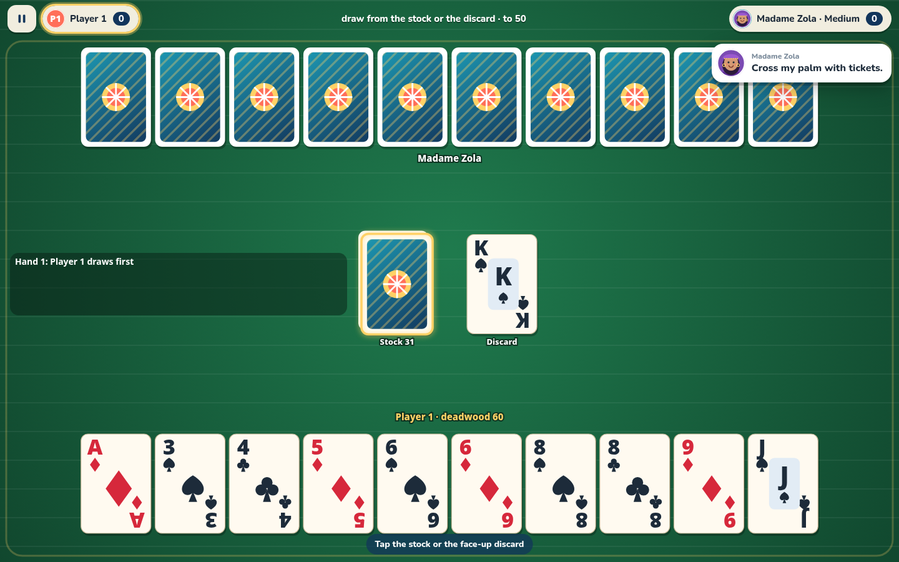

# Boardwalk Rivals

A beach-boardwalk game parlor in a single offline HTML file. Walk the boardwalk, step up to a booth, and play head-to-head on one device or against six boardwalk characters at Easy, Medium or Hard.

**Play:** https://chrisvonderau.github.io/boardwalk-rivals/ (or download `index.html` and open it; no internet needed)

## Live booths (25)
- **Wave 1:** Checkers, Chess, Connect Four, Reversi, Tic-Tac-Toe, Ultimate Tic-Tac-Toe, Air Hockey, Skee-Ball, Battleship.
- **Wave 2:** Backgammon, Chinese Checkers, Dots and Boxes, Mancala, Pong, Tank Duel, Ring Toss, Whack-a-Mole.
- **Wave 3:** Go Fish, Gin Rummy, Crazy Eights, War, Beach Dice (Yahtzee-style), Snake Battle, Mini Golf, Claw Challenge.

Fourteen more booths are coming in later waves.

## Controls
- **Xbox controller:** left stick / D-pad to move, A select, B back, X/Y game actions, LB/RB hop between booths, Start pause. Plug in two pads for head-to-head.
- **Keyboard and mouse:** arrows or WASD, Enter/Space, Esc to pause, click to play.
- **iPad and iPhone:** tap, drag and swipe, in portrait or landscape. Card games pass the device between players behind a "Pass to…" cover so hands stay hidden.

Win tickets, trade them for prizes, characters and boardwalk decorations. Progress is saved in your browser.

