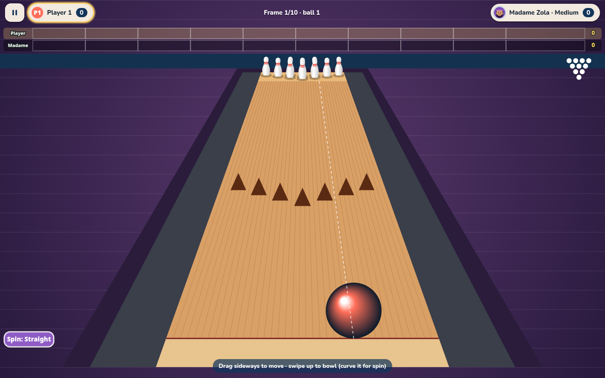

# Boardwalk Rivals

A beach-boardwalk game parlor in a single offline HTML file. Walk the boardwalk, step up to a booth, and play head-to-head on one device or against six boardwalk characters at Easy, Medium or Hard.

**Play:** https://chrisvonderau.github.io/boardwalk-rivals/ (or download `index.html` and open it; no internet needed)

## All 40 booths are live
- **Wave 1:** Checkers, Chess, Connect Four, Reversi, Tic-Tac-Toe, Ultimate Tic-Tac-Toe, Air Hockey, Skee-Ball, Battleship.
- **Wave 2:** Backgammon, Chinese Checkers, Dots and Boxes, Mancala, Pong, Tank Duel, Ring Toss, Whack-a-Mole.
- **Wave 3:** Go Fish, Gin Rummy, Crazy Eights, War, Beach Dice (Yahtzee-style), Snake Battle, Mini Golf, Claw Challenge.
- **Wave 4:** Go (9x9 or 13x13), Nine Men's Morris, Dominoes (draw or block), Mahjong Duel (race or take turns), Hangman (pick a secret word for your rival), Tidewords (a Scrabble-style word duel with a built-in offline word list), Darts (301 and Cricket), Tide Pool Race (a Parcheesi-style race for 2-4 players).
- **Wave 5:** Seashell Memory (a memory-match duel), Codebreaker Duel (Mastermind-style), Trivia Duel (399 built-in family-friendly questions in 12 categories, including Wilmington & NC, with no repeats in a visit), Bowling (10 frames with real scoring), Blackjack (both players vs. the house, racing on chips), Poker (Texas Hold'em, heads-up or up to 4 with AI fillers, pass-and-play hidden cards), Pinball Duel (alternating balls, multiball).

Every booth is open: all 40 booths, no coming-soon signs left.

## Controls
- **Xbox controller:** left stick / D-pad to move, A select, B back, X/Y game actions, LB/RB hop between booths, Start pause. Plug in two pads for head-to-head.
- **Keyboard and mouse:** arrows or WASD, Enter/Space, Esc to pause, click to play.
- **iPad and iPhone:** tap, drag and swipe, in portrait or landscape. Card games pass the device between players behind a "Pass to…" cover so hands stay hidden. On phones, small boards (Go, Chinese Checkers, Ultimate Tic-Tac-Toe, 8x8 boards in landscape) show a magnifier while your finger is down and snap the tap to the nearest legal move.

Win tickets, trade them for prizes, characters and boardwalk decorations. Progress is saved in your browser.

